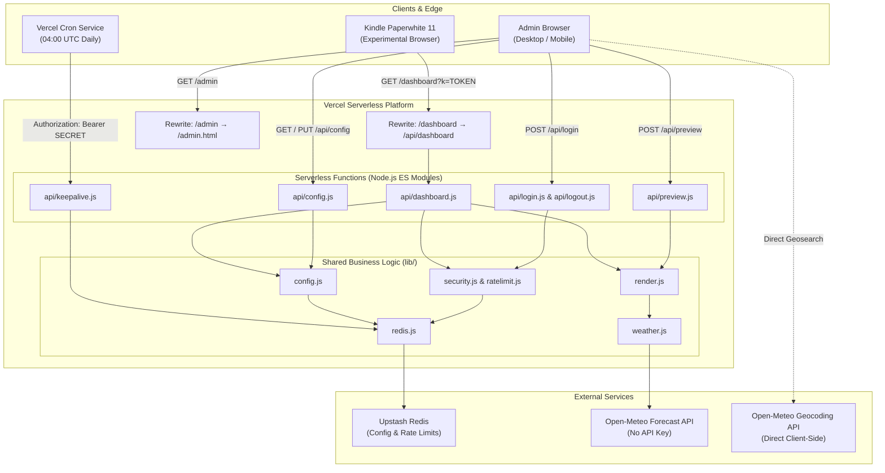

# System Architecture: AG Nova Slate Hub

This document details the architectural design, security mechanisms, data lifecycle, and hardware considerations for **AG Nova Slate Hub** (`ag-nova-slate-hub`).

For operator setup and deployment, see [README.md](file:///c:/Gemini%20projects/AG%20Nova%20Slate%20Hub/README.md).  
For release history, see [CHANGELOG.md](file:///c:/Gemini%20projects/AG%20Nova%20Slate%20Hub/CHANGELOG.md).  
For agent-specific rules, consult [CLAUDE.md](file:///c:/Gemini%20projects/AG%20Nova%20Slate%20Hub/CLAUDE.md) and [GEMINI.md](file:///c:/Gemini%20projects/AG%20Nova%20Slate%20Hub/GEMINI.md).

---

## 1. High-Level System Architecture

AG Nova Slate Hub operates as a zero-build, serverless micro-hub optimized for low-power e-ink devices like the Kindle Paperwhite 11. It pairs pure server-side HTML rendering with an Upstash Redis database and the Open-Meteo API.



---

## 2. Directory Structure & Component Responsibilities

The project strictly follows a zero-build pipeline without bundlers (no Vite, Webpack, or TypeScript compiler). All code uses native Node.js ES Modules (`"type": "module"`):

```
ag-nova-slate-hub/
├── api/                    # Vercel serverless HTTP endpoints
│   ├── config.js           # GET / PUT terminal configuration (authenticated)
│   ├── dashboard.js        # Public Kindle dashboard endpoint (token protected)
│   ├── keepalive.js        # Scheduled cron handler for database persistence
│   ├── login.js            # Admin authentication with rate limiting
│   ├── logout.js           # Session revocation
│   └── preview.js          # Live draft preview rendering (authenticated)
├── lib/                    # Shared pure business logic (no HTTP routes)
│   ├── config.js           # Schema validation, defaults, and sanitization
│   ├── http.js             # Minimal Node req/res helpers & body parsing
│   ├── ratelimit.js        # Fixed-window IP rate limiter
│   ├── redis.js            # Upstash Redis client singleton
│   ├── render.js           # HTML/CSS generator for e-ink display
│   ├── security.js         # Constant-time comparison & HMAC session cookies
│   └── weather.js          # Open-Meteo WMO decoder and forecast fetcher
├── public/                 # Static assets served directly by edge CDN
│   ├── admin.html          # Single-file NASA-punk configuration panel
│   └── index.html          # Fallback root landing page
├── vercel.json             # Routing rewrites, security headers, and cron specs
├── package.json            # Project metadata; single dependency (@upstash/redis)
├── .env.example            # Environment variable template
└── .gitignore              # Ignored local files (.env, node_modules, etc.)
```

---

## 3. Data Flow & Slot Engine

The dashboard layout is modular and driven by an orientation-aware slot engine managed in `lib/render.js` and `lib/config.js`:

### Portrait Mode (Default / Native Kindle)
Optimized for the Kindle Experimental Browser's native portrait viewport (3:4 ratio):

| Slot Identifier | Layout Position | Typical Module | Description |
| :--- | :--- | :--- | :--- |
| `top` | Vertical stack: top pane | `clock` | High-impact chronometer, stardate, day/month, and timezone |
| `middle` | Vertical stack: center pane | `weather` | Current temperature, WMO icon/status, humidity, wind, and forecast table |
| `bottom` | Vertical stack: bottom pane | `report` | Dynamic terminal status quote or mission notes |

*Active panels dynamically share vertical height using flexbox (`flex: 1`), automatically expanding if any slot is set to `none`.*

### Landscape Mode (Roadmap)
Designed for horizontal screens and mounted devices:

| Slot Identifier | CSS Grid Role | Typical Module | Description |
| :--- | :--- | :--- | :--- |
| `main` | `grid-row: 1 / 3` (Dominant left pane) | `clock` | High-impact clock, stardate, day/month, and timezone |
| `side1` | Right pane, top module | `weather` | Current temperature, WMO icon/status, humidity, wind, and forecast table |
| `side2` | Right pane, lower module | `none` or extra | Optional secondary widget |
| `footer` | Full-width bottom bar (`grid-column: 1 / 3`) | `report` | Dynamic terminal status quote or mission notes |

### Available Modules
1. **`clock`**: Displays active time, optional 24h format, localized formatted date, and active timezone.
2. **`weather`**: Fetches weather metrics from Open-Meteo, with a configurable 3-hour interval forecast (up to 6 slots).
3. **`report`**: Randomly samples one line from the user's custom `report.lines` array on each refresh.
4. **`none`**: Renders an empty cell to allow flexible asymmetric layouts.

---

## 4. Redis Key Schema

All persistent state is stored in Upstash Redis via `@upstash/redis`:

```
nova:config
  Type: JSON Object / String
  TTL: None (Persistent)
  Description: Active committed configuration (version, slots, weather coords, report lines).

nova:ratelimit:login:<ip>
  Type: Integer Counter
  TTL: 900 seconds (15 minutes)
  Description: Failed/attempted login counts per IP address. Exceeding 5 locks out the IP.

nova:keepalive
  Type: ISO Timestamp String
  TTL: 3,456,000 seconds (40 days)
  Description: Read and overwritten daily by the Vercel keepalive cron to prevent free-tier archiving.
```

---

## 5. Security & Authentication Model

### 1. Constant-Time Timing Attack Mitigation
All credential evaluations (Kindle URL token, Admin PIN, Session verification) use `safeEqual` from [`lib/security.js`](file:///c:/Gemini%20projects/AG%20Nova%20Slate%20Hub/lib/security.js):
```javascript
export function safeEqual(a, b) {
  if (typeof a !== 'string' || typeof b !== 'string' || !a || !b) return false;
  const ha = crypto.createHash('sha256').update(a).digest();
  const hb = crypto.createHash('sha256').update(b).digest();
  return crypto.timingSafeEqual(ha, hb);
}
```
Hashing both values with SHA-256 prior to `crypto.timingSafeEqual` prevents execution time leakage regardless of input string lengths.

### 2. Session Cookies
- Admin sessions use HMAC-SHA256 signatures with `SESSION_SECRET`.
- Signed tokens are stored in an `HttpOnly`, `Secure`, `SameSite=Strict` cookie (`nova_admin`).
- Active session TTL is 7 days.

### 3. Brute-Force Rate Limiting
- `api/login.js` increments the IP counter before PIN verification.
- Limits are capped at 5 attempts per 15-minute window.
- When an IP is locked out, even the correct PIN will be rejected until the window expires.

### 4. Cron Invocation Protection
- `api/keepalive.js` validates that incoming requests pass `Authorization: Bearer <CRON_SECRET>`, preventing unauthorized external triggers.

---

## 6. Hardware & E-Ink Display Constraints

The Kindle Paperwhite 11 runs a specialized, power-constrained WebKit engine in its Experimental Browser:

1. **ES5 Client Scripts Only**:
   The inline clock updating mechanism injected into the dashboard uses strict ES5 (`var`, `function`, legacy DOM methods). Modern ES6+ features (`const`, `let`, arrow functions) can crash or stall the Kindle browser.
2. **Monochrome High-Contrast Palette**:
   The dashboard CSS uses strict pure black (`#000`) and pure white (`#fff`) with geometric borders (`vmin`-based units). Grayscale shades are avoided on critical typography to prevent e-ink ghosting.
3. **Native vs. CSS Rotation**:
   If the Kindle is physically placed in landscape orientation, `rotation: 0` is preferred if the browser handles orientation. When mounted in fixed brackets, `rotation: 90` or `rotation: 270` handles software CSS transforms with `-webkit-` vendor prefixes.
4. **Meta Refresh Cycle**:
   The dashboard automatically refreshes the entire document via `<meta http-equiv="refresh" content="...">` every `N` minutes (default 15). The client ES5 script handles the minute-by-minute clock ticks between full page refreshes to conserve battery and avoid screen flashes.

