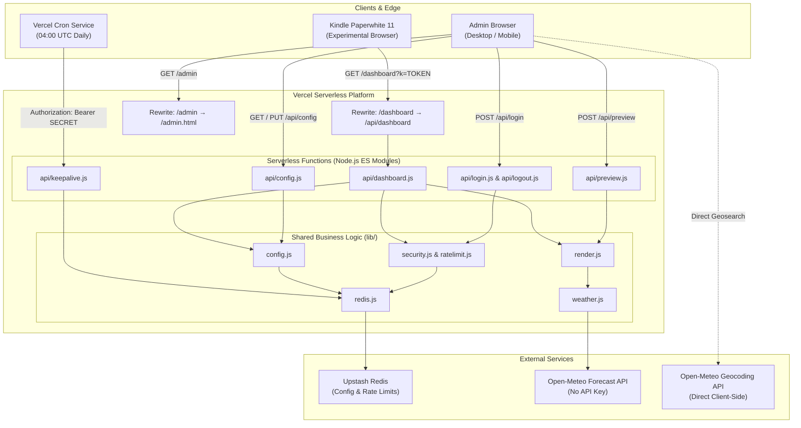

# System Architecture: AG Nova Slate Hub

This document details the architectural design, security mechanisms, data lifecycle, and hardware considerations for **AG Nova Slate Hub** (`ag-nova-slate-hub`).

For operator setup and deployment, see [README.md](file:///c:/Gemini%20projects/AG%20Nova%20Slate%20Hub/README.md).  
For release history, see [CHANGELOG.md](file:///c:/Gemini%20projects/AG%20Nova%20Slate%20Hub/CHANGELOG.md).  
For agent-specific rules, consult [CLAUDE.md](file:///c:/Gemini%20projects/AG%20Nova%20Slate%20Hub/CLAUDE.md) and [GEMINI.md](file:///c:/Gemini%20projects/AG%20Nova%20Slate%20Hub/GEMINI.md).

---

## 1. High-Level System Architecture

AG Nova Slate Hub operates as a zero-build, serverless micro-hub optimized for low-power e-ink devices like the Kindle Paperwhite 11. It pairs pure server-side HTML rendering with an Upstash Redis database and the Open-Meteo API.



---

## 2. Directory Structure & Component Responsibilities

The project strictly follows a zero-build pipeline without bundlers (no Vite, Webpack, or TypeScript compiler). All code uses native Node.js ES Modules (`"type": "module"`):

```
ag-nova-slate-hub/
├── api/                    # Vercel serverless HTTP endpoints
│   ├── config.js           # GET / PUT terminal configuration (authenticated)
│   ├── dashboard.js        # Public Kindle dashboard endpoint (token protected)
│   ├── keepalive.js        # Scheduled cron handler for database persistence
│   ├── login.js            # Admin authentication with rate limiting
│   ├── logout.js           # Session revocation
│   └── preview.js          # Live draft preview rendering (authenticated)
├── lib/                    # Shared pure business logic (no HTTP routes)
│   ├── config.js           # Schema validation, defaults, and sanitization
│   ├── http.js             # Minimal Node req/res helpers & body parsing
│   ├── ratelimit.js        # Fixed-window IP rate limiter
│   ├── redis.js            # Upstash Redis client singleton
│   ├── render.js           # HTML/CSS generator for e-ink display
│   ├── security.js         # Constant-time comparison & HMAC session cookies
│   └── weather.js          # Open-Meteo WMO decoder and forecast fetcher
├── public/                 # Static assets served directly by edge CDN
│   ├── admin.html          # NASA-punk configuration panel (inline JS, framework CSS)
│   ├── index.html          # Signal terminal landing page
│   ├── slate-hub-logo.svg  # Brand mark and favicon
│   ├── css/                # 00 fonts, 01-06 vendored AG Nova framework, 08 Slate Hub extensions
│   ├── fonts/              # Self-hosted Space Grotesk, Inter Tight, IBM Plex Mono (OFL 1.1)
│   └── js/                 # nova-shell.js (entrance animation release, stardate)
├── vercel.json             # Routing rewrites, security headers, and cron specs
├── package.json            # Project metadata; single dependency (@upstash/redis)
├── .env.example            # Environment variable template
└── .gitignore              # Ignored local files (.env, node_modules, etc.)
```

---

## 3. Data Flow & Layout Engine

The dashboard layout is driven by a weighted row engine in `lib/render.js`, configured through the `layout` object in `lib/config.js` (schema version 3).

### Orientation & Flip

The Kindle browser always renders in its native portrait viewport. Orientation is therefore applied in software, and the operator only chooses an orientation plus a 180° flip:

| `orientation` | `flipped: false` | `flipped: true` | Use case |
| :--- | :--- | :--- | :--- |
| `portrait` | 0° | 180° (`.rot180`) | Upright, or upside down with the cable pointing up |
| `landscape` | 90° (`.rot90`) | 270° (`.rot270`) | Device resting on either long side |

`rotationOf(cfg)` in `lib/config.js` is the single source of truth for this mapping. The admin preview (`/api/preview`) renders the logical layout **without** rotation inside a 3:4 or 4:3 frame, so it stays readable while editing; the flip state is shown in the preview header.

### Portrait Layout (3 Rows)

```js
layout.portrait.rows = [
  { height: 2, module: 'clock' },    // 50%
  { height: 1, module: 'weather' },  // 25%
  { height: 1, module: 'report' },   // 25%
]
```

### Landscape Layout (3 Rows x 2 Columns)

Row priority: rows first share the height by weight, then each row splits its own width between two columns.

```js
layout.landscape.rows = [
  { height: 2, split: [3, 2], cols: ['clock', 'weather'] },  // 50% height, 60/40 width
  { height: 1, split: [1, 1], cols: ['none', 'none'] },      // collapsed
  { height: 1, split: [1, 1], cols: ['report', 'none'] },    // auto-expanded to 100% width
]
```

### Sizing Rules

| Rule | Behaviour |
| :--- | :--- |
| Row height | `height` weight, 0.5 to 6 in 0.5 steps. Share = weight / sum of the visible rows' weights. |
| Column split | `split: [left, right]`, integers 1 to 9. Admin presets: 50/50, 60/40, 67/33, 70/30, 40/60, 33/67, 30/70. Other saved ratios show as CUSTOM. |
| Empty row | A portrait row with `none`, or a landscape row with both columns `none`, collapses; the remaining rows re-share the height. |
| Auto-expand | In landscape, if one column is `none`, the other takes 100% of the row width and the split is ignored. |
| Kindle flex | Weights are emitted as integers (`height x 2`) using `-webkit-box-flex`, `-webkit-flex` and `flex`, because legacy `-webkit-box-flex` is unreliable with decimals. |

### Typography Scaling

Frame chrome (status bars, panel tags, borders) is sized in `vmin`. Module typography is sized in `em`, and each panel receives an inline `font-size: <scale>vmin`. The scale is computed server-side from the box's estimated size against a reference box for each orientation (`REF` in `lib/render.js`):
- `clock` and `weather`: `min(widthRatio, heightRatio)`, clamped 0.45 to 1.6, so big numbers never exceed either dimension.
- `report`: `sqrt(widthRatio x heightRatio)`, clamped 0.7 to 1.4, so flowing text stays legible in wide, short rows.

Very small boxes (for example a 0.5 weight row with a 30% column) can still clip secondary content such as the forecast table; panels use `overflow: hidden`, so nothing leaks outside the box.

### Schema Migration

`sanitizeConfig` upgrades stored configs automatically:
- v1 flat `slots` and v2 `slots.portrait` / `slots.landscape` are mapped onto v3 rows (portrait rows get weight 1 each; landscape `main`+`side1` become row 1 at 60/40, `side2` row 2, `footer` row 3).
- v2 `rotation: 270` in landscape becomes `flipped: true`; every other v2 rotation becomes `flipped: false`.

### Available Modules
1. **`clock`**: Displays active time, optional 24h format, localized formatted date, and active timezone.
2. **`weather`**: Fetches weather metrics from Open-Meteo, with a configurable 3-hour interval forecast (up to 6 slots).
3. **`report`**: Randomly samples one line from the user's custom `report.lines` array on each refresh.
4. **`none`**: Empty cell. Collapses its row (portrait) or lets the other column auto-expand (landscape).

Several slots may use the same module (for example two clocks); the ES5 clock script updates every element with the `nova-clock` class.

---

## 4. Redis Key Schema

All persistent state is stored in Upstash Redis via `@upstash/redis`:

```
nova:config
  Type: JSON Object / String
  TTL: None (Persistent)
  Description: Active committed configuration (version 3: orientation, flipped, layout rows, weather coords, report lines).

nova:ratelimit:login:<ip>
  Type: Integer Counter
  TTL: 900 seconds (15 minutes)
  Description: Failed/attempted login counts per IP address. Exceeding 5 locks out the IP.

nova:keepalive
  Type: ISO Timestamp String
  TTL: 3,456,000 seconds (40 days)
  Description: Read and overwritten daily by the Vercel keepalive cron to prevent free-tier archiving.
```

---

## 5. Security & Authentication Model

### 1. Constant-Time Timing Attack Mitigation
All credential evaluations (Kindle URL token, Admin PIN, Session verification) use `safeEqual` from [`lib/security.js`](file:///c:/Gemini%20projects/AG%20Nova%20Slate%20Hub/lib/security.js):
```javascript
export function safeEqual(a, b) {
  if (typeof a !== 'string' || typeof b !== 'string' || !a || !b) return false;
  const ha = crypto.createHash('sha256').update(a).digest();
  const hb = crypto.createHash('sha256').update(b).digest();
  return crypto.timingSafeEqual(ha, hb);
}
```
Hashing both values with SHA-256 prior to `crypto.timingSafeEqual` prevents execution time leakage regardless of input string lengths.

### 2. Session Cookies
- Admin sessions use HMAC-SHA256 signatures with `SESSION_SECRET`.
- Signed tokens are stored in an `HttpOnly`, `Secure`, `SameSite=Strict` cookie (`nova_admin`).
- Active session TTL is 7 days.

### 3. Brute-Force Rate Limiting
- `api/login.js` increments the IP counter before PIN verification.
- Limits are capped at 5 attempts per 15-minute window.
- When an IP is locked out, even the correct PIN will be rejected until the window expires.

### 4. Cron Invocation Protection
- `api/keepalive.js` validates that incoming requests pass `Authorization: Bearer <CRON_SECRET>`, preventing unauthorized external triggers.

---

## 6. Hardware & E-Ink Display Constraints

The Kindle Paperwhite 11 runs a specialized, power-constrained WebKit engine in its Experimental Browser:

1. **ES5 Client Scripts Only**:
   The inline clock updating mechanism injected into the dashboard uses strict ES5 (`var`, `function`, legacy DOM methods). Modern ES6+ features (`const`, `let`, arrow functions) can crash or stall the Kindle browser.
2. **Monochrome High-Contrast Palette**:
   The dashboard CSS uses strict pure black (`#000`) and pure white (`#fff`) with geometric borders (`vmin`-based units). Grayscale shades are avoided on critical typography to prevent e-ink ghosting.
3. **Software Rotation**:
   The Kindle browser is kept in its native portrait mode. Landscape and flipped layouts are drawn with CSS transforms (`.rot90`, `.rot180`, `.rot270`, all with `-webkit-` prefixes) driven by `orientation` + `flipped`. Free rotation values are no longer accepted.
4. **Meta Refresh Cycle**:
   The dashboard automatically refreshes the entire document via `<meta http-equiv="refresh" content="...">` every `N` minutes (default 15). The client ES5 script handles the minute-by-minute clock ticks between full page refreshes to conserve battery and avoid screen flashes.

---

## 7. Visual System

The admin panel (`/admin`) and the landing page (`/`) are built on the AG Nova visual framework, the same one used by the other AG Nova sites. The Kindle dashboard is deliberately outside this system.

### Stylesheet stack

Load order is the same in `index.html` and `admin.html`:

| File | Role | Editable here? |
| :--- | :--- | :--- |
| `00-fonts.css` | `@font-face` for the three font roles, self-hosted from `public/fonts/` | Yes |
| `01-tokens.css` | Colour, type, spacing, structure and motion variables | No (vendored) |
| `02-base.css` | Reset, typography defaults, scrollbars, scanline overlay | No (vendored) |
| `03-layout.css` | OS shell, header strip, viewport, grids, taskbar | No (vendored) |
| `04-components.css` | Panels, keys, buttons, chips, data rows, voice block | No (vendored) |
| `05-animations.css` | Cross-document view transitions, panel flicker, pulse | No (vendored) |
| `06-responsive.css` | Tablet and pocket-datapad breakpoints | No (vendored) |
| `08-slatehub.css` | Slate Hub only: form controls, toggle, slot schematic, preview bezel, landing cards | Yes, tokens only |

`07-uplink.css` (the N.O.V.A. chat view) is not used by Slate Hub and is intentionally not included.

### Rules

- Files `01` to `06` are byte-identical copies of the framework. Updating the look means replacing them, never patching them.
- `08-slatehub.css` never overrides a framework class. New classes carry the `hub-` prefix and read colours, type and spacing only through `var(--...)` tokens.
- Colour is semantic. Cyan marks live or operational state (active mode button, `LIVE` chips, preview and link panels), orange marks work in progress (`UNSAVED CHANGES`, auto-expanded slots, flip engaged), ivory marks the N.O.V.A. voice (report panel, system note), and danger is reserved for genuine failures (wrong PIN, lockout, save error).
- Pages share one shell: header strip, `nova-viewport`, and the taskbar as the only navigation (`HUB`, `ADMIN CONSOLE`). Header and taskbar are named view-transition elements, so only the viewport animates between `/` and `/admin`.
- `public/js/nova-shell.js` adds the `is-ready` class that releases the paused panel entrance animation and fills `[data-stardate]` with the same `YY.DOY` format the Kindle dashboard uses. A `<noscript>` rule disables the entrance animation when scripts are off.

### Fonts

| Role | Token | Family | Files |
| :--- | :--- | :--- | :--- |
| Structure | `--font-heading` | Space Grotesk | `space-grotesk-var.woff2` (variable) |
| Reading | `--font-body` | Inter Tight | `inter-tight-var.woff2` (variable) |
| Data | `--font-mono` | IBM Plex Mono | `ibm-plex-mono-400/500/600/700.woff2` |

`vercel.json` serves `/fonts/*` with a one-week cache and `Access-Control-Allow-Origin: *`. The CORS header is required because the admin preview iframe is sandboxed (opaque origin), so its font requests are cross-origin.

### Kindle dashboard exception

`lib/render.js` keeps its own monochrome `#000` / `#fff` stylesheet. The only brand alignment is the font: it declares IBM Plex Mono 400 and 700 (WOFF2 with a WOFF fallback for the legacy WebKit engine) and falls back to Courier New. Both fonts advance 0.6 em per glyph, so the box-sizing engine and every layout calculation are unchanged.
